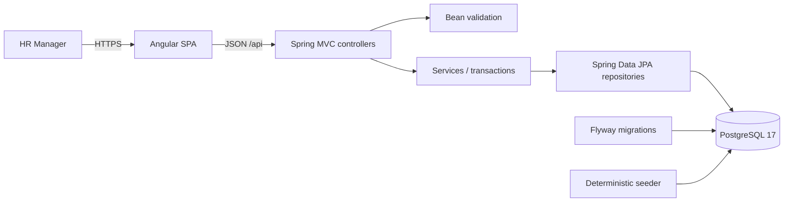
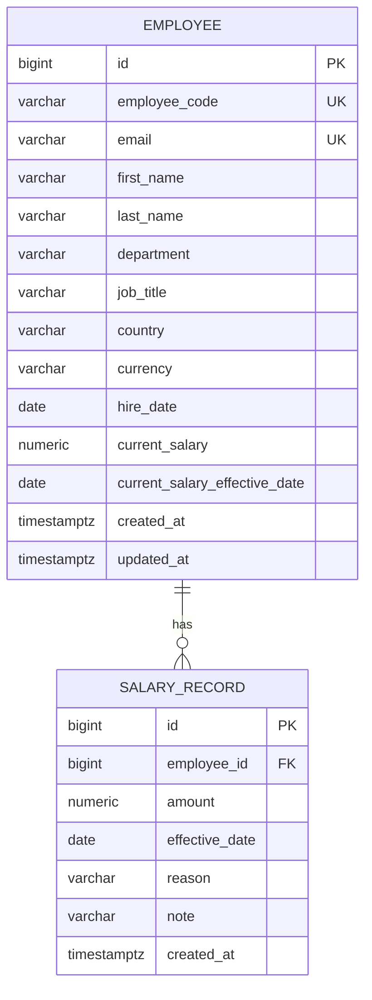

# Architecture

## Shape of the system

A modular monolith: one Spring Boot application, one PostgreSQL database, and one Angular
single-page application. This is intentionally the smallest architecture that satisfies
the requirements and remains easy to explain and operate.



In production mode the Angular build is copied into the Spring Boot jar and served as
static files. In development the Angular CLI dev server proxies `/api` to the backend.

## Backend packages

```text
com.acme.payroll
├── employee     employee aggregate, directory queries, employee service/controller
├── salary       salary history entity, repository, change/history service and DTOs
├── analytics    read-only aggregate queries and dashboard endpoint
├── common       API errors, exception handling, CORS, reference-data validation
└── seed         deterministic 10,000-employee demonstration data
```

Each feature keeps its controller, DTOs, service, repository, and entity together.
Controllers do HTTP work, services own business rules and transaction boundaries, and
repositories own persistence queries. Entities are never serialised by the API.

## Database model



`SALARY_RECORD` is the append-only history. `EMPLOYEE.current_salary` and
`current_salary_effective_date` are a deliberate read model so the employee list and
analytics do not need a "latest salary per employee" join on every request. Both are
updated in the same transaction as a new history row, and tests verify they agree.

### Indexes

- Unique indexes on employee code and email enforce identity rules.
- Unique `(employee_id, effective_date)` on salary records prevents duplicate dates and
  makes overlap impossible under the increasing-date rule.
- Indexes on `department`, `country`, `currency`, and `(employee_id, effective_date)`
  support filters, grouping, and history reads.
- Name/email search uses `LIKE '%term%'`; at 10,000 rows a sequential scan is a few
  milliseconds. A trigram index would add operational cost without a measured need.

## API

| Method | Path | Purpose |
| --- | --- | --- |
| GET | `/api/employees` | Paginated search and filters |
| POST | `/api/employees` | Create employee + initial salary |
| GET | `/api/employees/{id}` | Employee profile |
| PUT | `/api/employees/{id}` | Edit mutable employee fields |
| GET | `/api/employees/{id}/salaries` | Salary history, newest first |
| POST | `/api/employees/{id}/salaries` | Record a salary change |
| GET | `/api/analytics/summary` | Headcount and payroll grouped by currency, department, country |

List query parameters: `search`, `department`, `country`, `currency`, `page`, `size`,
`sortBy`, `direction`. Pagination is zero-based. `size` is capped at 100.

## Key decisions and trade-offs

### Denormalised current salary

The alternative was to derive current salary from history with a correlated subquery or
a window function on every list and analytics request. That is more "normalised" but
makes the most common read paths harder to read and paginate. Since salary writes are
centralised in one service method with a row lock and one transaction, the denormalised
fields cannot drift through normal application use. The seeder and an integration test
also assert consistency. If salary history became editable, this choice would be
revisited.

### Strictly increasing effective dates instead of interval editing

A salary record is a point-in-time change. Each record's period runs until the next
record's date. Requiring each new date to be strictly after the latest date makes
overlaps impossible and keeps the write path simple. The trade-off is no backdating or
future scheduling, which are documented as out of scope.

### No currency conversion

No exchange-rate source or accounting policy exists. Reports therefore group by
currency and show per-currency totals. Adding a conversion layer later would require a
rate source, effective dates for rates, and an audit policy.

### Server-side pagination and filtering

The directory never loads 10,000 rows into the browser. The API applies filters,
ordering, and pagination in PostgreSQL through Spring Data JPA. The UI keeps filter
state in the URL so a page can be bookmarked or refreshed.

### H2 for automated integration tests

Repository/API integration tests run against H2 in PostgreSQL compatibility mode so the
suite is fast and does not require Docker or a local database. The real application is
verified separately against PostgreSQL 17, including Flyway migrations and the 10k seed.
This trade-off is documented rather than hidden; a CI pipeline could add a PostgreSQL
service container for a second integration pass.

### Single deployable jar

For the assessment demo, the Angular production build is copied into
`backend/src/main/resources/static` and served by Spring Boot. This avoids CORS and a
separate web server in the deployed artifact. During development, `ng serve` uses a proxy
to keep hot reload.

## Performance approach

- Seed inserts use JDBC batches, not 10,000 individual JPA flushes.
- The list query is paginated and backed by simple indexes.
- Analytics perform three grouped SQL queries, not one query per employee.
- The UI debounces text search and requests only one page at a time.
- Measured timings are recorded in the README after end-to-end verification.

No cache, message broker, or distributed component is needed at this scale.
